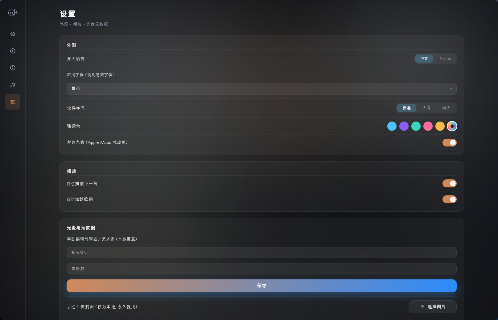
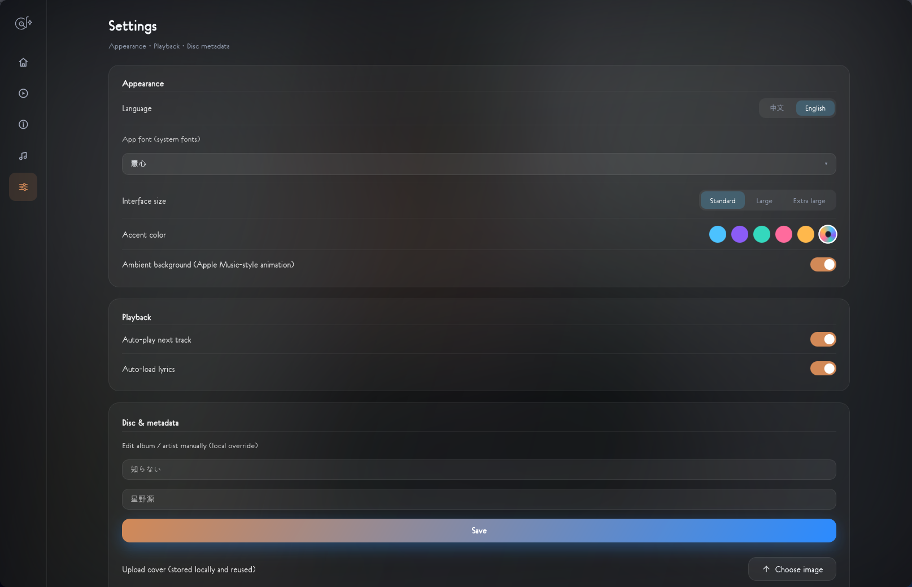

# Gleam

[English](README.md) | **简体中文**

一款给 Linux 桌面用的实体 CD 播放器，基于 Tauri 2、React 和 libmpv。

插入光盘后，Gleam 读取 TOC，从 MusicBrainz 获取发行信息，再加载封面、专辑介绍和歌词。识别过的光盘会保存在本地，下次插入直接使用。

**当前版本：** [v1.1.0 Bug Fixes (2026-10-31)](https://github.com/ocarinal/gleam/releases/tag/v1.1.0-bugfix-2026-10-31) · [更新日志](CHANGELOG.md)

## 界面






## 功能

- **CD 播放** — 进程内 libmpv、TOC、进度、音量、播放队列、随机和循环。
- **光盘识别** — MusicBrainz DiscID；DiscID 未收录时用 MCN/ISRC 兜底。支持进度提示、重新匹配、手动搜索和提交 DiscID。
- **本地光盘库** — 搜索、拖动排序、A/B/C/D 碟组合集；点击卡片查看大封面、专辑/歌手介绍和曲目。
- **歌词** — LRCLIB、网易云、QQ 音乐、酷狗；右键切换来源，支持逐字、翻译、手动查找和缓存。
- **界面** — 中英文切换、封面流动氛围、可收起侧栏、固定强调色或跟随封面取色、慧心字体、115% 缩放。
- **键盘** — 空格播放暂停、方向键快进/音量、`Ctrl`+方向键切歌、`N/P`、`M`、`S`、`R`、`L`、`Q` 以及媒体键。

## 技术栈

| 部分 | 技术 |
|---|---|
| 桌面框架 | Tauri 2 / Rust |
| 前端 | React + TypeScript + Vite |
| 播放 | libmpv（进程内 FFI） |
| CD 读取 | Linux ioctl |
| 元数据 | MusicBrainz |
| 歌词 | LRCLIB / 网易云 / QQ 音乐 / 酷狗 |
| 存储 | 本地 JSON + 缓存 |

## 快速开始

目前仅支持 Linux。需要 `libmpv`、`webkit2gtk-4.1`、Rust 和 Node.js 18+。

**Arch / CachyOS**

```bash
sudo pacman -S webkit2gtk-4.1 mpv base-devel nodejs npm libcdio
```

**Debian / Ubuntu**

```bash
sudo apt install build-essential curl file libssl-dev \
  libwebkit2gtk-4.1-dev libgtk-3-dev librsvg2-dev \
  libayatana-appindicator3-dev libmpv2 mpv libcdio-utils nodejs npm
```

`cd-info`（来自 `libcdio` / `libcdio-utils`）是可选依赖，用于按条码/ISRC 兜底识别。

```bash
git clone https://github.com/ocarinal/gleam.git
cd gleam
npm install
npm run tauri dev
```

正式构建：

```bash
npm run tauri build
```

光驱没有权限时：

```bash
sudo usermod -aG optical $USER
```

重新登录即可。

## 说明

- 目前仅支持 Linux，光盘读取依赖 Linux ioctl。
- 歌词和部分元数据来自非官方 Web API，可能随时变化，请遵守各服务条款。
- 没有 DiscID、MCN、ISRC 和 CD-TEXT 的光盘无法自动识别；请使用手动搜索或提交 DiscID。

## 许可

MIT。元数据、歌词和封面归各数据提供方所有。
